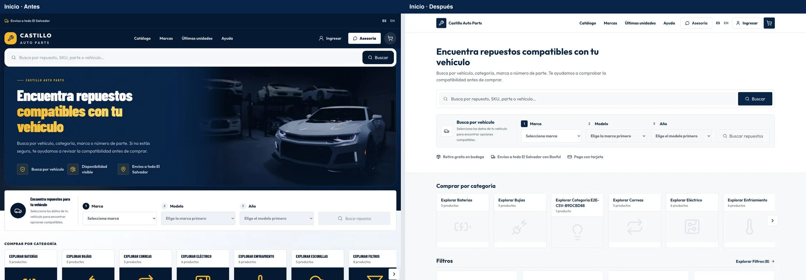
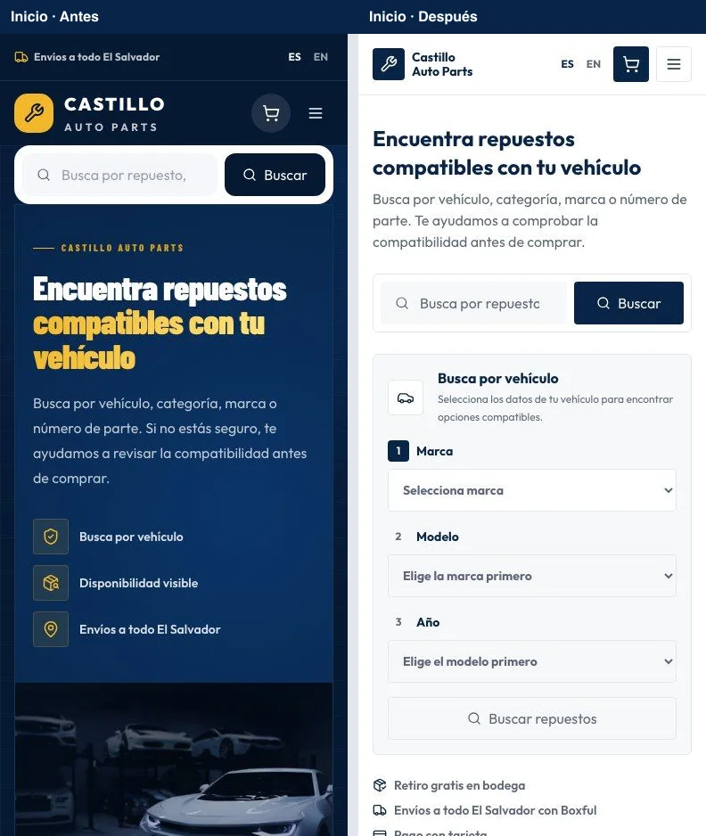

# Comparación visual del storefront

Capturas en Chromium con el mismo catálogo de prueba; carrito y checkout tienen un artículo. La columna izquierda muestra `main` (`8a515b0`); la derecha muestra el rediseño del issue #134.

| Página | Escritorio · 1440 × 960 | Móvil · 390 × 900 |
| --- | --- | --- |
| Inicio | [Antes y después](desktop-home.webp) | [Antes y después](mobile-home.webp) |
| Catálogo | [Antes y después](desktop-catalog.webp) | [Antes y después](mobile-catalog.webp) |
| Producto | [Antes y después](desktop-product.webp) | [Antes y después](mobile-product.webp) |
| Carrito | [Antes y después](desktop-cart.webp) | [Antes y después](mobile-cart.webp) |
| Checkout | [Antes y después](desktop-checkout.webp) | [Antes y después](mobile-checkout.webp) |
| Ayuda | [Antes y después](desktop-help.webp) | [Antes y después](mobile-help.webp) |

## Condiciones de la revisión

- La captura se tomó en el primer viewport de cada página, después de cargar Outfit. Las dos columnas usan el mismo producto de prueba.
- El carrito y checkout muestran el flujo previo al pago. Se usaron proveedores de prueba, sin guías ni cargos reales.
- Se comprobó también navegación en inglés a 320 px, foco visible de teclado y contraste de los pares principales de texto sobre las superficies claras (mínimo 4.5:1).
