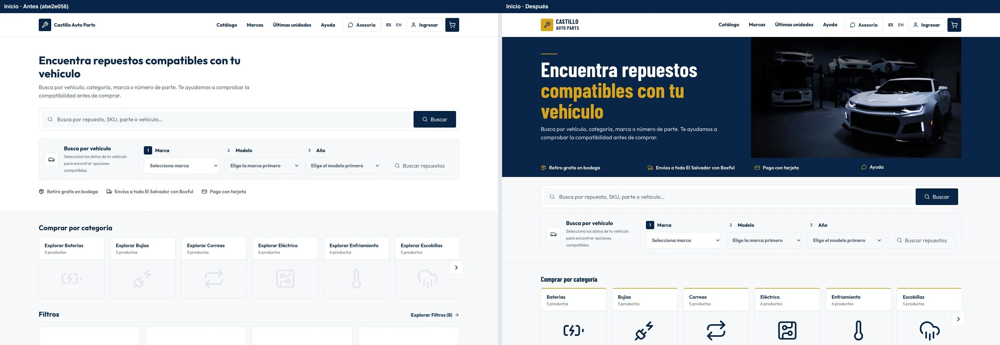
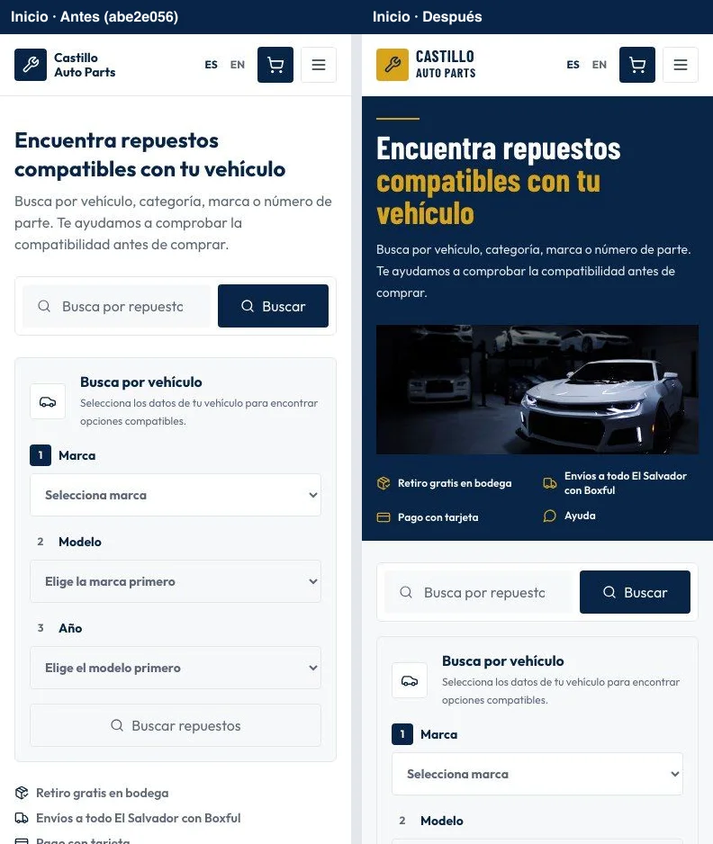
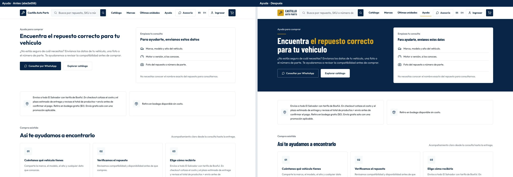
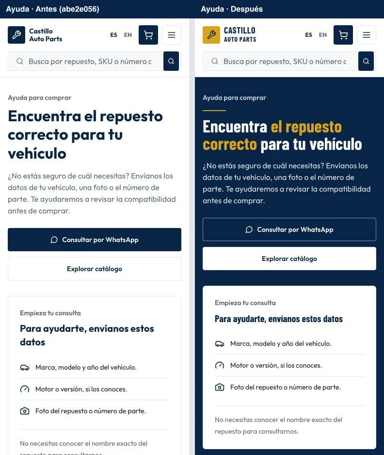

# Identidad del storefront: revisión del PR #135

Comparación de Inicio y Ayuda en Chromium con el mismo catálogo de prueba, el carrito vacío y sin número de WhatsApp configurado. A la izquierda está el commit revisado, `abe2e056`; a la derecha, los ajustes de identidad.

| Página | Escritorio · 1440 × 960 | Móvil · 390 × 900 |
| --- | --- | --- |
| Inicio | [Antes y después](desktop-home.webp) | [Antes y después](mobile-home.webp) |
| Ayuda | [Antes y después](desktop-help.webp) | [Antes y después](mobile-help.webp) |

Con un número de prueba configurado se verificó aparte que los botones abren un enlace `wa.me`, muestran verde sólido y alcanzan 4.87:1 con texto blanco. El número de prueba no se guarda en el proyecto.

La [comparación original con main](../README.md) conserva la evidencia del primer ajuste visual.
