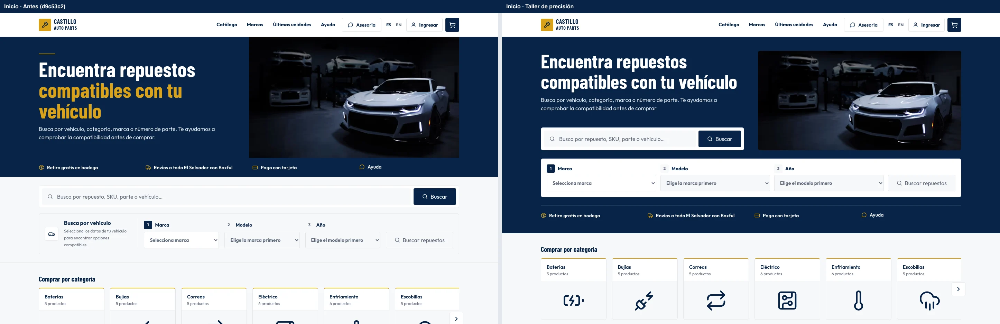
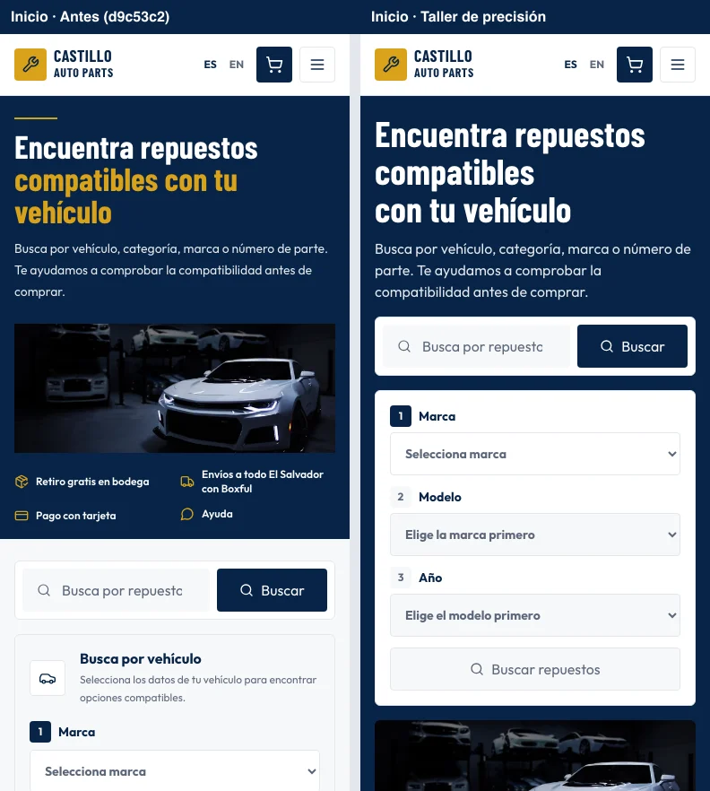

# Inicio: Taller de precisión

Comparación en Chromium, con el mismo catálogo de prueba y el carrito vacío. La columna izquierda es el estado revisado del PR #135 (`d9c53c2`); la derecha aplica la [nueva dirección del banner](https://github.com/EliezerCast1llo/castillo-auto-parts/pull/135#issuecomment-6779043580).

| Escritorio · 1440 × 900 | Móvil · 390 × 844 |
| --- | --- |
| [Antes y después](desktop-home.webp) | [Antes y después](mobile-home.webp) |

En móvil el selector completo, incluido su botón, termina a 749 px en español. La fotografía va después del formulario y los beneficios después de la fotografía. En escritorio, la fotografía ocupa la columna derecha junto al titular y el buscador; el selector y los beneficios ocupan el ancho del banner.

