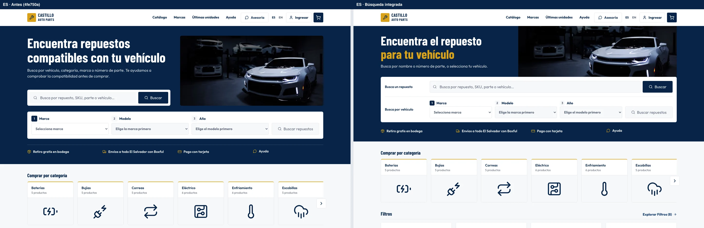
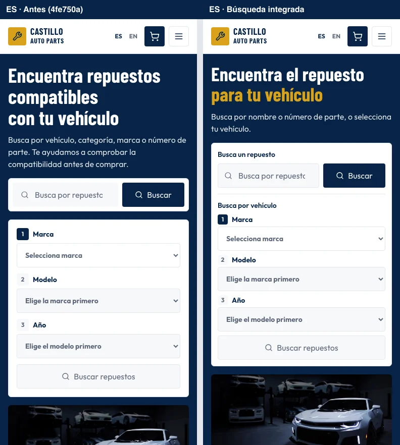
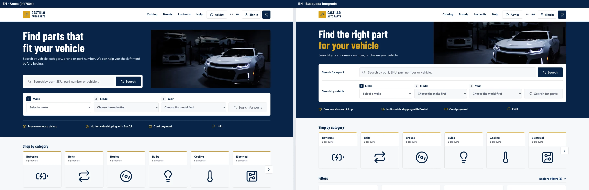
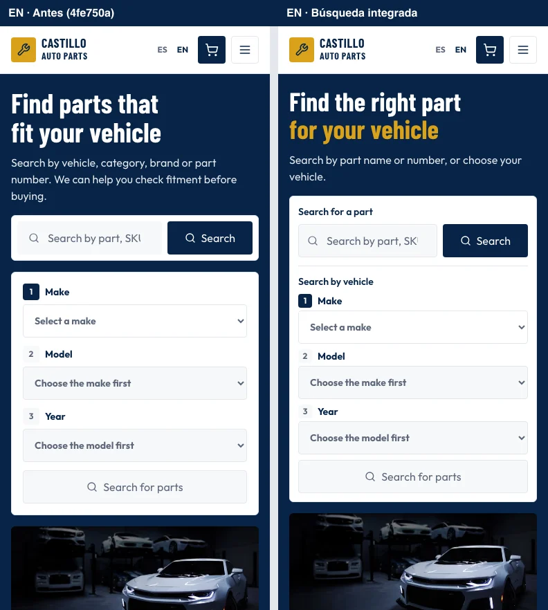

# Inicio: búsquedas integradas

Comparativas de la revisión solicitada en el [comentario 6779955409](https://github.com/EliezerCast1llo/castillo-auto-parts/pull/135#issuecomment-6779955409). La izquierda muestra `4fe750a`; la derecha, el titular más breve, la foto alineada al banner y las dos búsquedas en una misma tarjeta. Chromium, mismo catálogo de prueba y carrito vacío.

| Idioma | Escritorio · 1440 × 900 | Móvil · 390 × 844 |
| --- | --- | --- |
| Español | [Antes y después](desktop-es-home.webp) | [Antes y después](mobile-es-home.webp) |
| Inglés | [Antes y después](desktop-en-home.webp) | [Antes y después](mobile-en-home.webp) |

En ambos idiomas, el formulario móvil y su botón terminan aproximadamente a 675 px; la tarjeta termina a 688 px y la foto empieza después. Los campos siguen midiendo 48 px y el botón se vuelve dorado al completar la selección.

